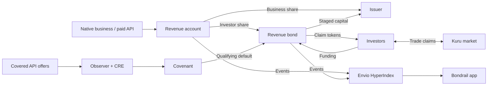

# Bondrail

[](https://github.com/calledAdo/bondrail/actions/workflows/ci.yml?query=branch%3Anext)

> **Metropolis judges:** the submitted version is the tag
> [`metropolis-submission`](https://github.com/calledAdo/bondrail/tree/metropolis-submission) (commit `2f8d3e5`,
> 11 Oct 2026). Its live app (https://bondrail.vercel.app) and contracts are unchanged. Commits after the 13 Oct deadline,
> which the organisers exclude from judging, continue the product: see [`BUILD_LOG.md`](BUILD_LOG.md) and
> [`docs/deployments/NEXT-RUNBOOK.md`](docs/deployments/NEXT-RUNBOOK.md).


**Revenue bonds for onchain businesses.**

**Issue bonds. Raise capital. Repay investors from your revenue.**

Bondrail lets revenue-generating onchain businesses raise capital by issuing revenue bonds on Monad.
Investors assess the business's payment history and bond terms, fund a raise, and receive transferable
claim tokens. An agreed share of the business's connected revenue flows toward repayment, up to a cap.
Capital is released in stages as the business demonstrates revenue after activation.

The working prototype supports native smart-contract businesses and paid x402 APIs. Native integrations
split fees inside the business transaction; account-mediated x402 settlement verifies the payer and
books/splits API revenue immediately through `BondrailAccount.settle`. Plain transfers still need `sweep()`.
Repayment depends on revenue. These claims do not promise fixed interest, full principal recovery, or a liquid exit.

[Open next](https://bondrail-next-web.vercel.app) · [Explore bonds](https://bondrail-next-web.vercel.app/markets) ·
[Documentation](https://bondrail-next-web.vercel.app/docs) · [GitHub](https://github.com/calledAdo/bondrail)

Built for **Metropolis — Onchain Finance & Trading**. Current `next` deployment: **Monad testnet, chain 10143; not audited**.
Demo payments and trades use controlled test wallets; they are evidence of functionality, not customer traction.

## Features on `next`

- **Reviewed Native templates:** `factory.deployNative` deploys and binds approved code without individual
  review. Custom contracts inheriting `BondrailEarner` need individual review before raising.
- **Account settlement and facilitator:** `account.settle` verifies EIP-3009 payments and books/splits
  immediately. The separate gas-funded facilitator has verification, settlement, health and recovery code.
- **Performance triggers:** `bond.checkTrigger` can step up the investor share below an agreed booked-revenue
  floor and restore it on a later check. Investors can `bond.withdraw` while the raise is open.
- **Credit vault:** carried-cost bond allocations, separate entry/exit prices, seven-day income vesting and
  idle-liquidity-limited exits. The deployed vault's web view is read-only; deposits/exits are contract calls.
- **Portable credit profiles:** `onchainProfile` exposes exact state and bond coverage; `attestedProfile`
  adds a separately trusted assessment with current-signer and expiry checks.
- **Yield and credit line:** SDK `impliedYield` estimates returns at the trailing revenue rate; `creditLine`
  estimates a raise using history, concentration, stress and coverage. Both are advisory, not promises
  or factory-enforced borrowing limits.

## Install

```sh
npm i @bondrail/sdk viem
npm i @bondrail/contracts
```

The SDK is prepared at **0.1.1** (0.1.0 had broken exports), and the Solidity package at **0.1.0**.
This work does not publish either package. If the version is unavailable, use the tarball instructions
in the [SDK README](packages/sdk/README.md) and [contracts README](packages/contracts/README.md).
Solidity users can also `forge install calledAdo/bondrail@next`; use the package README's remappings.
A version-pinned `forge install calledAdo/bondrail@contracts-v0.1.0` requires that tag to exist first.
See [release preparation](RELEASING.md); no tags are created here.

## Why Bondrail

An onchain business can earn fees without having an asset it wants to sell or enough collateral to borrow
against. Bondrail gives it a way to offer investors a capped share of future revenue, with terms and
collections visible onchain.

For investors, the product brings the issuer's revenue history, payer concentration, capital releases,
repayment pool, and covenant observations into one place. For developers, the contracts and SDK connect
revenue collection to financing without building a separate repayment system.

## How a revenue bond works

1. **Connect revenue.** Create a revenue account in the token the business earns. Native businesses bind
   a reviewed contract; paid APIs direct supported x402 payments to the account. Payment history can
   accumulate before the first raise.
2. **Set the terms.** Choose the raise amount, revenue share, repayment cap, deadlines, stake, and
   second-release milestone. Each account has one attached bond at a time. The current factory enforces
   a minimum history period; the testnet deployment uses 10 minutes for demonstration.
3. **Fund the bond.** Investors deposit the account's asset and receive claims 1:1. Before the funding
   deadline, they can withdraw their deposit while the bond remains in its funding phase. Activation
   requires the full raise. If the deadline passes without activation, anyone can cancel the raise and
   holders can claim refunds.
4. **Release capital in stages.** Activation releases 25% or 50% of the raise. The remainder requires
   the agreed revenue milestone and operating period within the release window. The milestone uses
   either the account's onchain revenue counter or a signed, wash-adjusted attestation. Unreleased
   capital can be recovered for claim holders after the deadline or a qualifying covenant default.
5. **Collect repayments.** While collection is active, the agreed share of connected revenue goes to
   the bond. x402 payments can use `account.settle` to prove the payer and split revenue in the same
   transaction; `sweep()` remains for other transfers.
   The effective repayment cap scales with capital actually released. Collection closes when
   the cap is reached or a maturity-close transaction executes; Watched bonds then have an evidence window.
   **Optional performance trigger (`checkTrigger`):** terms can step the investor share
   up (for example, 25% → 40%) when booked revenue falls below a floor over 1–30 complete UTC days.
   Anyone can call `checkTrigger()` once per UTC day while Active and not defaulted; a later check at
   or above the floor restores the base share. Checks start only when the entire window falls strictly
   after the activation UTC day: `today >= activationDay + 1 + triggerWindowDays`. They exclude the
   activation day and current partial day, and run outside payments. Without a check, the last share
   persists. This works on-chain for both tiers and does not change the cap.
6. **Hold, trade, or redeem.** Listed claims can trade on Kuru, subject to available liquidity. Redemption
   burns claims for their share of the current pool. **Early redemption gives up those claims' rights to
   future revenue and recoveries.** It is not a payout withdrawal that preserves the position. The last
   outstanding claim must wait for the bond to close.

Revenue collected, unreleased capital recovered, and slashed stake are tracked separately. A bond can
reach maturity below its cap without a revenue-routing breach; low revenue and covenant default are
not the same outcome.

The trigger counts **all booked account revenue, including money the issuer pays itself**. Padding
revenue to avoid a trigger costs the issuer real money because investors receive their share, but it
is possible. This counter is not the indexer's attributed or wash-adjusted revenue. The entire
activation-day bucket is excluded, including receipts before and after activation; plain transfers
count on the day they are swept.
All three trigger terms must be zero to disable it. See [trigger terms](apps/web/content/docs/concepts/bond.mdx).

## Bondrail Credit vault

`BondrailVault` lets investors deposit one asset (such as USDC) for ERC-4626 shares;
a disclosed curator allocates across eligible Funding bonds. Healthy positions carry unrecovered cost,
so activation preserves NAV and deposits stay open. Entries ignore unrealized impairments; exits apply
a 50% performance-trigger haircut or a 30-day default/maturity writedown. Repayments replace cost first;
realized profit enters both prices over seven days after a checkpoint. New profit merges with the
unvested remainder, so later inflows can extend that remainder's vesting. Collection cannot unlock it early.
`totalAssets()` and conversions report **exit NAV**; use `previewDeposit`/`previewMint` for entry quotes.
Carrying at cost assumes healthy bonds keep paying; impairment is rule-based, not a market price.

The vault never redeems claims early. Withdrawals use idle liquidity only, with no queue or guaranteed
exit. Fixed allocation limits are 25% of exit NAV per bond, 16 holdings, and 20% idle remaining; concentrations
can drift and withdrawals can consume that buffer. The immutable owner can only replace the curator
after a two-day delay. There are no arbitrary calls, rescue transfers, fee recipients or upgrades.

The current next manifest includes the vault. The app's `/vault` page shows entry/exit prices, NAV and
unvested income; it remains read-only. See the [current vault guide](apps/web/content/docs/concepts/credit-vault.mdx),
[design arithmetic](docs/vault/DESIGN.md) and [validation](docs/vault/VALIDATION.md). The design document
records its original pre-deployment status; current addresses are listed below.

## Two revenue integrations

| Integration | How it works | Trust boundary |
|---|---|---|
| **Native** | A business inherits `BondrailEarner` and binds its revenue account. Payments in (`collect`) and payouts out (`settleOut`) book fees and split the investor share in the same transaction. An optional fee floor applies while the bond is active. | A disclosed reviewer approves individual contracts or reusable templates. Routing is enforced for that reviewed contract's payment path; a business can still stop operating or move customers elsewhere. |
| **Watched** | An x402 API publishes its revenue account and covered endpoints in `/.well-known/bondrail.json`. Account-mediated x402 settlement proves the payer and books/splits immediately; direct transfers still use `sweep()`. Chainlink CRE checks payment offers against the committed policy. | Monitoring covers declared endpoints and observed offers. It cannot prove that every customer sees the same offer or discover all undeclared endpoints. The testnet deployment uses a trusted observer signer. |

Watched bonds require a stake. Two qualifying violation reports in adjacent 30-second epochs record a
default, recover unreleased principal, and slash held stake into the investor pool. Sustained Unknown
reports also have a separate default path. Missing monitor reports do not establish issuer misconduct.
Already released capital cannot be clawed back by these contracts.

The configured testnet reporter runs every 30 minutes and retries a violation in the next epoch. This is
an operating schedule, not a guaranteed detection time. [Reporter setup](ops/covenant-server/README.md).

## Revenue history and suggested terms

Envio HyperIndex supplies payment history, daily revenue, payer totals, repayment splits, and bond
lifecycle events. Native contract events identify the payment participant; supported x402 settlements
are attributed using the sender's EIP-3009 authorization. Other transfers are unclassified inflows.
Detected issuer-funded payments and unclassified inflows are excluded from attributed revenue.

**An attributed payer with no detected funding link is not necessarily an independent customer.** The
current detector identifies direct treasury links; it is not a complete ownership or wash-trading detector.

The account page shows an **advisory raise estimate**, based on attributed daily revenue, investor share,
term, history length, and payer concentration. The SDK applies a stress haircut and coverage margin.
This estimate is not a credit rating, a financing commitment, or a factory-enforced borrowing limit.
See [`packages/sdk/src/credit.ts`](packages/sdk/src/credit.ts).

Accounts retain history across bonds. The credit registry exposes recorded repayment outcomes and detects
omissions through `bondsCreated`/`complete`; attested credit limits remain advisory. It does not enforce
repeat-issuer underwriting or provide an automatic reputation service.

## Try the product

No application login is required to browse. Open [Markets](https://bondrail-next-web.vercel.app/markets), select a
bond, and inspect its terms, revenue history, current backing, and transaction evidence. Connect a browser
wallet or use the Mera passkey connector to interact on Monad testnet.

For funding, obtain test USDC from [Circle's faucet](https://faucet.circle.com) and test MON for gas. The
app also provides a configured testnet gas drip, subject to its balance and limits.

**Metropolis submission (judged) — CurveLab** is the historical judge-access example: bond
[`0xD4E5901cce4A7173903F75e6e0327020f5C18B05`](https://bondrail.vercel.app/bonds/0xD4E5901cce4A7173903F75e6e0327020f5C18B05).
Its configured funding deadline is 28 October 2026. Check its current phase in the app before depositing;
it may fill or activate earlier. While funding remains open, approve the asset, deposit, and optionally
withdraw. After cancellation, use the refund action instead.

### Demonstration evidence

| Recording | What it demonstrates | Guide and transaction evidence |
|---|---|---|
| Technical demo — 2:40 | LaunchLab issuance, funding, staged activation, actual Native repayment, and a trade in the separate PumpLab Kuru market | [Technical demo](demo/video/TECHNICAL-DEMO.md) |
| Founder pitch — 1:48 | Team, problem, motivation, and product | [Founder pitch](demo/video/FOUNDER-PITCH.md) |
| Chainlink CRE — 1:36 | CLI simulation, signed observation checks, broadcast, and an accepted onchain report | [CRE demo](demo/video/CHAINLINK-DEMO.md) |
| Envio — 1:27 | A payment receipt matched to live HyperIndex records and the product's revenue view | [Envio demo](demo/video/ENVIO-DEMO.md) |

These links point to recording notes and evidence. Public video-host URLs are maintained separately in
the hackathon submission. Recordings use actual testnet operations with edited timing, not speed benchmarks.

## Integrations

- **Monad:** settlement for revenue collection, bond funding, repayments, and trading. Small, frequent
  payments are a core use case; the demo API charges 0.01 test USDC per request.
- **Envio HyperIndex:** the app's core indexed data layer, with dynamic account/bond registration,
  payment attribution, treasury-funding links, and lifecycle history.
  [Handlers](indexer/src/handlers/bondrail.ts) · [Schema](indexer/schema.graphql).
- **Chainlink CRE:** independently fetches payment offers, checks agreement with a signed observer
  result, and submits reports to the covenant. The demonstrated setup is **CLI simulation with real
  testnet broadcasts**, not a production DON deployment. Activation and second release for Watched
  bonds require a fresh compliant report. [Workflow](cre/bondrail-covenant/src/workflow.ts).
- **Kuru:** claim/USDC markets backed by an order book and AMM vault. The issuer console supports
  listing; the bond page supports buys and sells. Quotes simulate the actual market order, include
  price impact and fees, and apply a 1% minimum-output tolerance. Quotes older than 30 seconds are
  refreshed before submission. Trading price and cash backing are shown separately.
  [Trading UI](apps/web/src/components/app/trade.tsx).
- **x402:** SDK payment handler and buyer guard for APIs that direct payments to their revenue account.
  [Handler](packages/sdk/src/x402.ts) · [Guard](packages/sdk/src/x402-guard.ts).
- **ERC-8004:** an agent registration and a demo script that can publish negative feedback after a
  recorded covenant default. This is not yet an automated business-reputation service or a guarantee
  of agent output quality. [Script](demo/scripts/erc8004.ts).
- **Mera:** passkey wallet access alongside external wallets.
- **Nansen:** optional server-side payer-label lookups on Monad mainnet. Unlabelled testnet wallets do
  not establish customer independence. [API route](apps/web/src/app/api/nansen/route.ts).

## Current testnet deployment (`next`)

Source: [`docs/deployments/10143-next.json`](docs/deployments/10143-next.json), chain 10143, deployed
15 October 2026. The manifest identifies this independent testnet deployment; it does not attest service
uptime or which later source revisions have been rolled out. All contracts are **not audited**.

| Service | Live URL |
| --- | --- |
| Web and docs | https://bondrail-next-web.vercel.app |
| Oracle Agent | https://bondrail-next-agent.vercel.app |
| Facilitator | https://bondrail-next.64-227-40-35.sslip.io |
| Envio GraphQL | https://indexer.dev.hyperindex.xyz/1ac5720/v1/graphql |

| Contract / role | Address from next manifest |
| --- | --- |
| Factory | `0x94c86517a520e56f104c6c82b96632643b3f5d81` |
| Covenant | `0x901021116203aaf92fbc427ce8a440a4c4ccfcda` |
| Account implementation | `0xf1ad610cf89fd047d1718fbff843e0288eea86c5` |
| Bond implementation | `0x95427c18841dc8a5b6240a5337a9a4382f380c69` |
| Credit vault | `0x57fd6a271a6a4e96b151e5d0732c7f61e3059f07` |
| Credit registry | `0x8cb78ff328cd4982030f275d017892fd2fa512f8` |
| Test USDC | `0x534b2f3A21130d7a60830c2Df862319e593943A3` |
| CRE mock forwarder | `0xB9F79d863261869B234c481D1f9A7af84AeAd192` |
| Native reviewer | `0xbFAaF97B7fd74279b68962F990a9876Eb8968B46` |
| Credit attester | `0x0500a7eDeD5425a7F94045674aBDc5BC0e55119E` |
| Vault curator | `0xc927A118aDb0b19CDE4d51f77a34bA59b36B3c9b` |
| Facilitator gas wallet (service role) | `0x0CE7D559B9A87E600a117F5A3EdBb6B552028B36` |

| Demo business | Account | Bond |
| --- | --- | --- |
| PumpLab | `0x0c58cE2d764C089AEfe8dA8cA27C2E521BDC31F5` | `0xb6f44e47C7468c42A32d9679170cC3C4B145099B` |
| CurveLab | `0x9decB240F7e063fcC090AF740341b956B7A3B079` | `0x16813A1Ba366Ea5d1375F5B64B0BC8348642a735` |
| Oracle Agent | `0x067861e4bf4803a66DB97cF74E252B6F4927FA54` | `0x66A9aAfad577A6319645F4E2E2daAad42a987343` |

Web reference addresses are generated from the selected manifest at build time (`BONDRAIL_DEPLOYMENT=next`).
See the [next runbook](docs/deployments/NEXT-RUNBOOK.md) for facilitator `/health`, gas budgets, receipt
reconciliation and separate service roles. The facilitator is an HTTP service; its wallet is not a
protocol contract or a custody address.

### Metropolis submission (judged)

The preserved submission manifest is [`docs/deployments/10143.json`](docs/deployments/10143.json).
These historical addresses and recording evidence are separate from `next` and must not be used with
next ABIs or signed domains. The LaunchLab recording has its own receipt journal in the technical demo guide.

| Contract / asset | Monad testnet address |
|---|---|
| Factory (`SliceFactory`, live legacy deployment) | `0xef7916dc8c95338cd060d498528484e97aa3c597` |
| Covenant (`SliceCovenant`, live legacy deployment) | `0x96a3fe15d3f311728ae836b9b0a7ad2feb252cb3` |
| Test USDC | `0x534b2f3A21130d7a60830c2Df862319e593943A3` |
| CRE mock forwarder | `0xB9F79d863261869B234c481D1f9A7af84AeAd192` |
| LaunchLab technical-demo bond | `0xa57E7Bd5c0874e195C192a43a6caF8aA22335C35` |
| Oracle Agent Watched bond | `0xd30bf6d5ecf1f55D1212F1a66F9521eEFBA50c21` |
| PumpLab Kuru market | `0x6492423ca48E33C8D82D085a97B830C9f86a5720` |

Historical submission/demo evidence:

- Native revenue split: [`0xf0ac64…d6e89`](https://testnet.monadscan.com/tx/0xf0ac64fe77bf20f4aee6a9ca2941620ca60530687ae3dd97c8afc868d72d6e89).
- CRE accepted compliant observation: [`0x51baff…9c452`](https://testnet.monadscan.com/tx/0x51baffd86c3cd274b3f486245bf2dde54d1a515cca01b62d77f7e3d47639c452).
- Kuru demo purchase: [`0xa7f7d6…b2cad`](https://testnet.monadscan.com/tx/0xa7f7d63d4277787f4b60bcf177855a0aac6b989e5a02425c127ce16ecb6b2cad).

### Architecture



Contracts hold funds and enforce the financing lifecycle. The indexer supplies views; the observer and
CRE inspect covered payment offers; the keeper submits collection and lifecycle transactions. Users
sign app transactions through their wallets. Offchain services do not custody investor deposits.

| Directory | Purpose |
|---|---|
| [`contracts/src`](contracts/src) | Account, bond, factory, covenant, vault, credit registry and integration interfaces |
| [`packages/contracts`](packages/contracts) | `@bondrail/contracts`: canonical Solidity sources, npm/Git imports and external example |
| [`packages/sdk`](packages/sdk) | `@bondrail/sdk`: clients, ABIs, permits, payment helpers, raise estimate |
| [`packages/scoring`](packages/scoring) | Revenue scoring, evidence reconciliation, Envio and Nansen clients |
| [`apps/web`](apps/web) | Next.js app, markets, issuer console, portfolio, and documentation |
| [`indexer`](indexer) | Envio HyperIndex configuration and event handlers |
| [`services`](services) | Observer, collection/lifecycle worker, x402 facilitator and credit attester |
| [`cre`](cre) / [`ops`](ops) | CRE workflow and reporter deployment instructions |
| [`demo`](demo) | Example businesses, test traffic, recordings, and reproduction scripts |

Stack: Solidity 0.8.28, Foundry, OpenZeppelin, TypeScript, viem, Next.js 16, React 19, wagmi,
Tailwind CSS, Fumadocs, Envio HyperIndex, Chainlink CRE, x402, Kuru, and Mera.

## Run locally

Requirements: Node.js 24, pnpm 10.32.0, and [Foundry 1.8.4](https://getfoundry.sh). CRE work additionally requires
[Bun](https://bun.sh) and the [CRE CLI](https://docs.chain.link/cre).

```sh
git clone https://github.com/calledAdo/bondrail.git
cd bondrail
pnpm check:all
```

Run `pnpm check:all` before submitting a change. It installs both workspaces with frozen lockfiles,
checks Solidity sizes and tests, runs every TypeScript project and the standalone indexer checks,
verifies both package tarballs, and builds `demo/agent` and `apps/web` for production. GitHub Actions
runs the same checks in four parallel jobs on pushes and PRs to `main`/`next`.
See [CONTRIBUTING.md](CONTRIBUTING.md) for individual commands, required merge checks, the existing
Solidity formatting exception, and expected durations. Release preparation is in [RELEASING.md](RELEASING.md).

`pnpm check` remains a faster workspace-only check. Production builds use Next.js's default
Turbopack bundler; a passing development server or typecheck alone does not verify production
module resolution. Package verification also exercises an isolated plain-Node SDK consumer and
an [external Foundry consumer](examples/native-project).

Source-consumed workspace packages (`shared`, `sdk`, `observer`, and `scoring`) use TypeScript
bundler resolution. Use extensionless relative imports (or existing `.ts` imports where allowed)
for TypeScript source; do not use `.js` specifiers for files that exist only as `.ts`.
The SDK build emits JavaScript with resolvable `.js` specifiers for published consumers.

Start Anvil in one terminal:

```sh
anvil
```

In a second terminal, deploy and seed the Native example, then start the local data service:

```sh
BONDRAIL_CHAIN_ID=31337 pnpm tsx scripts/deploy.ts
BONDRAIL_CHAIN_ID=31337 pnpm tsx demo/scripts/setup-demo.ts pumplab
BONDRAIL_CHAIN_ID=31337 pnpm tsx demo/scripts/traffic-launchpad.ts pumplab organic 1
BONDRAIL_CHAIN_ID=31337 pnpm tsx demo/scripts/setup-demo.ts pumplab
BONDRAIL_CHAIN_ID=31337 pnpm tsx scripts/dev-indexer.ts
```

The second setup run advances the local clock past the minimum-history requirement. The local data
service listens on port 8546 and reads Anvil state; it is a development substitute for HyperIndex, not
an Envio deployment. Local MockUSDC does not implement EIP-3009, so use testnet for x402 settlement.

Copy [`apps/web/.env.example`](apps/web/.env.example) to `apps/web/.env.local`. Set the following values,
using `asset` and `factory` from the generated `docs/deployments/31337.json`:

```dotenv
NEXT_PUBLIC_CHAIN_ID=31337
NEXT_PUBLIC_RPC_URL=http://127.0.0.1:8545
NEXT_PUBLIC_INDEXER_URL=http://127.0.0.1:8546
NEXT_PUBLIC_USDC_ADDRESS=<asset address from local deployment>
NEXT_PUBLIC_FACTORY_ADDRESS=<factory address from local deployment>
```

Start the app in a third terminal:

```sh
pnpm dev
```

Open `http://localhost:3000` and connect a local development wallet. Publish the issuer's signed profile
from the console to include it in the default market view. Anvil's public development keys are for local
use only. Profile and market registry storage is in memory without the optional Redis configuration.

### Deploy your own testnet instance

For a separately authorized deployment, build contracts and configure a funded deployer as described in
[`scripts/lib.ts`](scripts/lib.ts). Select a new name, for example
`BONDRAIL_DEPLOYMENT=my-testnet pnpm tsx scripts/deploy.ts`, to write `docs/deployments/10143-my-testnet.json`.
Never overwrite `docs/deployments/10143.json` (Metropolis submission, judged), or reuse `next` for another instance.
Demo setup requires test USDC and MON and waits for the configured minimum history on testnet.

Configure the web app with the new addresses and indexer URL. Generate indexer configuration with
`BONDRAIL_DEPLOYMENT=my-testnet node indexer/gen-config.mjs 10143`. See the [observer](services/observer/README.md),
[worker](services/worker/README.md), [CRE workflow](cre/bondrail-covenant/README.md), and
[reporter operations](ops/covenant-server/README.md) for their separate configuration. Watched policies
must match the deployed account, bond, covenant, and observer signer.

## Current boundaries

- **Prototype, not audited production finance.** Foundry tests include lifecycle, fuzz, and accounting
  invariants; TypeScript tests cover scoring, observation, and worker behavior. Passing tests do not
  establish production safety, business demand, or creditworthiness.
- **Revenue quality remains imperfect.** Self-payments through unlinked wallets can evade attribution
  filters. Onchain milestone counters include booked inflows, including self-funded ones. Signed
  milestones add a disclosed attester trust assumption.
- **Monitoring is bounded.** CRE currently runs as simulation with broadcast and a single pinned
  observer signer. Deposit checks reject known violations but do not require a fresh compliant report;
  activation and second release do. A monitor outage is not proof of issuer default.
- **Recovery is limited.** Default can recover undrawn principal and held stake, not capital already
  released. A stake need not cover the investor's entire exposure. Maturity can close below the cap.
- **Markets need liquidity.** A Kuru listing does not guarantee a buyer or a fair exit price.
- **Assets have their own risks.** Accounts use one ERC-20 asset for revenue, funding, and repayment;
  this avoids conversion but does not establish the token's value or safety.

## Naming and compatibility

Bondrail was developed under the working name **Slice**. On `next`, Solidity contracts, SDK exports,
workspace packages and operator environment variables use Bondrail / `BONDRAIL_*`.
The EIP-712 domains are now `BondrailFactory`, `BondrailCovenant`, and `Bondrail Profile` (all v1).
This breaks old signatures and policies; these sources require fresh deployments and signatures.
The judged deployment in `docs/deployments/10143.json` remains historical and unchanged.

New policies and clients use `/.well-known/bondrail.json`; the agent serves `/.well-known/slice.json`
as an alias to the same document. Local credentials still default to `~/.slice` (override with
`BONDRAIL_KEY_DIR`), and the historical agent hostname is
`https://slice-agent.vercel.app/api/oracle`. The independent next service URLs are listed above. [Brand assets and migration notes](brand/bondrail/README.md).

## Build history, attribution, and license

Built by **Adokiye** for Metropolis. Development began on 9 October 2026 under the Slice name, following
an abandoned Zeitgeist concept; no code from that project was carried over. The build history is recorded
in [`BUILD_LOG.md`](BUILD_LOG.md), Git history, and `llmtimeline/`.

**AI disclosure:** OpenAI Codex and Claude Code were used extensively for implementation, review,
documentation, and demo production under the founder's direction. The technical and sponsor videos use
synthetic narration; the founder pitch uses the founder's own recording.

External libraries and tools include [OpenZeppelin](https://github.com/OpenZeppelin/openzeppelin-contracts),
[Foundry](https://github.com/foundry-rs/foundry), [viem](https://github.com/wevm/viem),
[wagmi](https://github.com/wevm/wagmi), [Next.js](https://github.com/vercel/next.js),
[React](https://github.com/facebook/react), [Fumadocs](https://github.com/fuma-nama/fumadocs),
[Tailwind CSS](https://github.com/tailwindlabs/tailwindcss), [Motion](https://github.com/motiondivision/motion),
[lucide](https://github.com/lucide-icons/lucide), [Geist](https://github.com/vercel/geist-font),
[Envio HyperIndex](https://github.com/enviodev/hyperindex), [Chainlink CRE](https://docs.chain.link/cre),
[x402](https://github.com/coinbase/x402), [Kuru SDK](https://www.npmjs.com/package/@kuru-labs/kuru-sdk), and
[Mera](https://www.npmjs.com/package/@category-labs/mera), each under its own license. Frontend design took
inspiration from Kokonut UI. External logo sources are recorded in
[`brand/bondrail/third-party/SOURCES.md`](brand/bondrail/third-party/SOURCES.md).

Bondrail source is [MIT licensed](LICENSE). Testnet demonstrations are not an investment offer or an
endorsement by Monad, Metropolis, or an integration provider.

### Portable credit registry

The next manifest includes `BondrailCreditRegistry`. `onchainProfile(account)` reads account counters
and current outcomes of up to 64 permissionlessly recorded factory bonds. `bondsCreated` counts every
issuance; `complete` compares that count with recorded membership. Show “Repayment record covers N of M
bonds” and warn when incomplete, including beyond the 64-bond bound. Booked revenue includes self-payments;
default flags inherit covenant observer trust.

`attestedProfile(account)` returns separately signed attributed/excluded revenue, payer concentration and
an advisory credit line. Valid means current attester and unexpired; previous signers and payloads remain
visible after a two-day attester rotation. The evidence hash commits to inputs, not their truth.
`@bondrail/sdk/credit.getCreditProfile` reads both layers and current signer at one block.
See [credit profiles](apps/web/content/docs/concepts/credit-profiles.mdx), the [design](docs/credit/DESIGN.md)
and [attester operations](services/attester/README.md). The design's pre-deployment status is historical.

The attester defaults to dry-run; relay backfills registry membership and verifies coverage before an
assessment. Envio stores chain/registry-scoped `BondRecorded` and `Attested` history; current expiry,
signer validity and completeness must still be evaluated from the registry. Generating Envio configuration
with `BONDRAIL_DEPLOYMENT=next` selects the registry from that manifest;
the checked-in default config remains historical. Other deployments need their own registry address.

`demo/scripts/erc8004.ts repaid` can explicitly publish positive feedback for the registered agent's bond only after final cap settlement with no default. The script checks that the account issuer owns the registered agent; default feedback remains available with `feedback`. It has no automatic watcher or deduplication: check existing reputation feedback before rerunning. These commands send transactions; they have not been run as part of this task.
