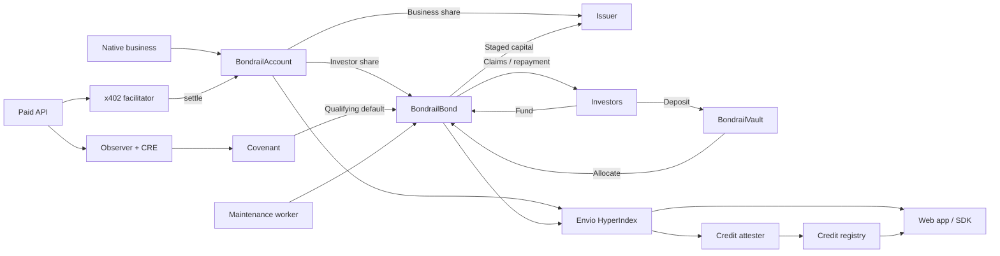

# Bondrail

[](https://github.com/calledAdo/bondrail/actions/workflows/ci.yml?query=branch%3Amain)

**Revenue bonds for onchain businesses.** Issue bonds, raise capital, and repay investors
from connected revenue. Businesses receive capital in stages; investors receive transferable
claims on an agreed revenue share up to a cap. Native smart contracts and paid x402 APIs
build payment history through a Bondrail account before raising.

[Open Bondrail](https://bondrail.vercel.app) · [Markets](https://bondrail.vercel.app/markets) ·
[Documentation](https://bondrail.vercel.app/docs) · [Vault](https://bondrail.vercel.app/vault)

The production app serves **Monad testnet (10143)**. The protocol is a prototype and is not
audited. Demo activity uses controlled wallets; repayment depends on revenue and market
liquidity is not guaranteed.

## Current deployment

Production runs `main` against [`docs/deployments/10143.json`](docs/deployments/10143.json),
deployed 15 October 2026 and promoted by the operator on 16 October. This manifest is the
source of contract identities; current service health and later code rollouts are separate.

| Service | Endpoint |
| --- | --- |
| App and docs | https://bondrail.vercel.app |
| Paid Oracle Agent | https://bondrail-next-agent.vercel.app |
| x402 facilitator | https://bondrail-next.64-227-40-35.sslip.io |
| Envio GraphQL | https://indexer.dev.hyperindex.xyz/89b08bb/v1/graphql |

The retained agent/facilitator hostnames are intentional. The production Envio project is
**bondrail-next**, released from **envio-next**; that release branch remains unchanged.

| Contract | Address |
| --- | --- |
| Factory | `0x94c86517a520e56f104c6c82b96632643b3f5d81` |
| Covenant (CRE receiver) | `0x901021116203aaf92fbc427ce8a440a4c4ccfcda` |
| Account implementation | `0xf1ad610cf89fd047d1718fbff843e0288eea86c5` |
| Bond implementation | `0x95427c18841dc8a5b6240a5337a9a4382f380c69` |
| Credit vault | `0x57fd6a271a6a4e96b151e5d0732c7f61e3059f07` |
| Credit registry | `0x8cb78ff328cd4982030f275d017892fd2fa512f8` |
| Test USDC | `0x534b2f3A21130d7a60830c2Df862319e593943A3` |
| CRE mock forwarder | `0xB9F79d863261869B234c481D1f9A7af84AeAd192` |

| Business | Revenue account | Bond |
| --- | --- | --- |
| PumpLab | `0x0c58cE2d764C089AEfe8dA8cA27C2E521BDC31F5` | `0xb6f44e47C7468c42A32d9679170cC3C4B145099B` |
| CurveLab | `0x9decB240F7e063fcC090AF740341b956B7A3B079` | `0x16813A1Ba366Ea5d1375F5B64B0BC8348642a735` |
| Oracle Agent | `0x067861e4bf4803a66DB97cF74E252B6F4927FA54` | `0x66A9aAfad577A6319645F4E2E2daAad42a987343` |

Signer roles, vault allocation and the frozen watch policy are in the same manifest.
The facilitator is an HTTP service; its gas wallet is not a custody contract.
`BONDRAIL_DEPLOYMENT` defaults to `main` and loads `<chainId>.json`. Named deployments
remain supported as `<chainId>-<name>.json`; use a fresh name for a separate deployment.
The docs address table reads the selected manifest at build time.

## Install

```sh
npm install @bondrail/sdk viem
npm install @bondrail/contracts
```

The SDK provides typed clients, ABIs, payments, credit profiles and revenue analytics.
The Solidity package provides contracts and `BondrailEarner` for Native integrations.
Prepared versions are SDK **0.1.1** and contracts **0.1.0**; if unavailable in your registry,
use the local tarball instructions in the [SDK README](packages/sdk/README.md) and
[contracts README](packages/contracts/README.md). Package preparation does not publish.
See the [Native example](examples/native-project) and [release guide](RELEASING.md).

## Features

- **Native revenue routing:** reviewed templates bind to an account; `collect` and `settleOut`
  book fees and split the investor share inside the business transaction.
- **Paid API settlement:** x402 EIP-3009 payments pass through `account.settle`, with payer
  attribution and repayment in one transaction. Durable journals handle replay and recovery.
- **Bond lifecycle:** funding withdrawals, staged capital releases, capped repayment,
  recovery of undrawn capital/stake, and claim redemption. Plain transfers need `sweep()`.
- **Performance triggers:** permissionless checks can raise the investor share below an
  agreed booked-revenue floor and restore it after recovery.
- **Credit vault:** pooled bond allocations, carried-cost accounting, separate entry/exit
  prices, seven-day income vesting and exits limited to idle assets. The app view is read-only.
- **Portable credit profiles:** onchain revenue/outcomes and bond coverage, plus separately
  signed assessments with expiry and current-attester checks. Evidence hashes identify inputs.
- **Investor and issuer tools:** markets, issuer console, portfolio, account history,
  optional Kuru claim trading, and advisory SDK credit-line/yield estimates.

The [trust model](https://bondrail.vercel.app/docs/trust-model) explains the reviewer,
attester, curator and observer roles. Connected revenue can include self-payments;
attestations do not prove business independence. Watched monitoring uses a pinned observer
and CRE simulation with broadcast, not DON consensus. Default recovery cannot reclaim
capital already released to the business.

## Architecture



Contracts hold funds and enforce the lifecycle. Envio supplies queryable history;
the attester records assessments, the observer/CRE checks frozen payment offers, and
the worker submits maintenance transactions. Users sign app transactions with their wallets.

| Directory | Purpose |
| --- | --- |
| `contracts/src` | Account, bond, factory, covenant, vault and credit registry |
| `packages/contracts`, `packages/sdk` | Solidity distribution and TypeScript SDK |
| `packages/shared`, `packages/scoring` | RPC pacing, chains, attribution and analytics |
| `apps/web` | Next.js app and documentation |
| `indexer` | Envio HyperIndex event handlers and schema |
| `services`, `cre`, `ops` | Observer, worker, facilitator, attester and CRE reporting |
| `demo`, `examples` | Paid agent, Native integrations, local scenarios and recorded evidence |

## Run locally

Use **Node.js 24**, **pnpm 10.32.0** and **Foundry 1.8.4** (`forge` and `anvil` on PATH).

```sh
git clone https://github.com/calledAdo/bondrail.git
cd bondrail
nvm use
pnpm check:all
pnpm e2e:local
```

`check:all` installs both workspaces with frozen lockfiles, runs Solidity sizes/tests,
workspace/scripts/indexer tests, every TypeScript check, SDK/contracts tarball verification,
and both production app builds. CI runs the same gates on `main` and `next`.
`e2e:local` starts isolated Anvil and HTTP services, exercises payments, bonds, vault and
attestation, then checks the app in Chromium. Install Playwright Chromium first with
`pnpm exec playwright install chromium` if neither it nor Chrome is available.
The rehearsal uses temporary keys and `31337-e2e.json`, protects both public manifests,
and stops its services on exit. No live key or funded wallet is needed.

For an interactive Native demo, start `anvil` in one terminal. In another:

```sh
export BONDRAIL_CHAIN_ID=31337 BONDRAIL_DEPLOYMENT=local BONDRAIL_ENV=local
export BONDRAIL_RPC_URL=http://127.0.0.1:8545 BONDRAIL_RPC_URLS=http://127.0.0.1:8545
export BONDRAIL_KEY_DIR="$(mktemp -d)"
pnpm tsx scripts/deploy.ts
pnpm tsx demo/scripts/setup-demo.ts pumplab --force
pnpm tsx demo/scripts/traffic-launchpad.ts pumplab organic 1
pnpm tsx demo/scripts/setup-demo.ts pumplab --force
INDEXER_URL=http://127.0.0.1:8546 pnpm tsx scripts/export-env.ts web > apps/web/.env.local
pnpm tsx scripts/dev-indexer.ts
```

The second setup advances only the local clock past the history requirement. `--force`
authorizes updates to this isolated manifest. Keep that shell's key directory for the
session; a restart with new keys will not own the existing deployment. Run `pnpm dev`
in a third terminal and open http://localhost:3000. Connect an Anvil development wallet;
use “Show all” in Markets until the issuer publishes a signed profile. The local indexer
adapter serves Anvil state; it is not an Envio Cloud deployment.

See [CONTRIBUTING.md](CONTRIBUTING.md) for check details and the existing Solidity formatting
exception. [Operations](ops/README.md), the [production runbook](docs/deployments/RUNBOOK.md)
and [October migration/rollback](docs/deployments/MIGRATION-2026-10.md) cover server setup.
Keep production state, keys and service namespaces intact during a naming migration.

## Metropolis submission

The judged code remains at [`metropolis-submission`](https://github.com/calledAdo/bondrail/tree/metropolis-submission).
Its read-only [archived manifest](docs/deployments/archive/10143-slice-metropolis.json)
and [`BUILD_LOG.md`](BUILD_LOG.md) preserve the submission and build history.
Those contracts predate the current ABIs and signed domains; use the current manifest above.

## Attribution and license

Built by Adokiye, with OpenAI Codex and Claude Code used for implementation, review,
documentation and demo production. Dependencies include OpenZeppelin, Foundry, viem, wagmi,
Next.js, React, Fumadocs, Tailwind, Envio HyperIndex, Chainlink CRE, x402, Kuru and Mera,
each under its own license. [Brand sources](brand/bondrail/third-party/SOURCES.md) record
external assets. Bondrail source is [MIT licensed](LICENSE).
