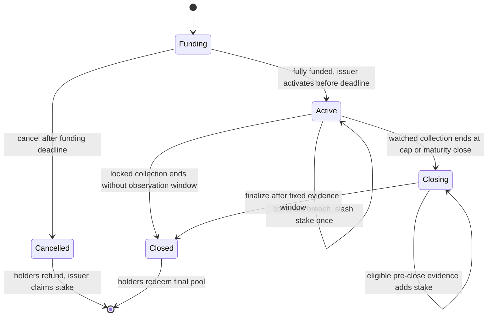
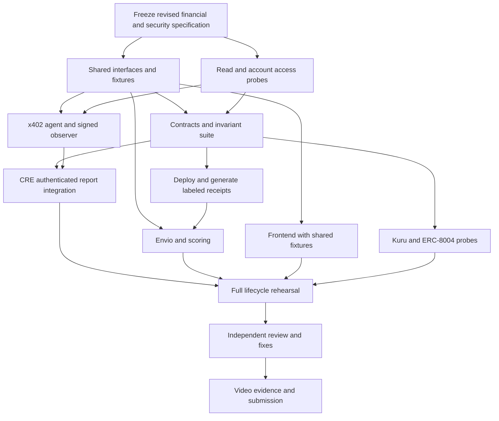

# Slice: architecture and execution plan

> **Latest amendment:** [Testnet and staged capital release](testnet-and-staged-release.md) takes precedence over mainnet-first demonstration, full-principal-at-activation, and fixed full-raise-cap assumptions below. Default development/integration is Monad testnet. Proposed two-stage drawdown releases 50/50 or25/75 under a frozen policy; undrawn principal recovery and proportional revenue caps require the accounting changes in that amendment.

Prepared 9 October 2026. Scope: design and build planning, not implementation. Based on the user's complete Slice specification, existing Metropolis research, three independent reviews, newly retrieved primary documentation, and limited read-only Monad RPC checks. See the [verification register](verification-register.md) for what was actually verified.

## 1. Recommendation

Build Slice as a **market for capped claims on a specifically committed revenue stream**. Keep the two demo issuers, USDC denomination, Router, tradable claim token, FeeGuard, CRE covenant, Envio history, and transparent underwriting. Those components form a coherent product.

Change several financial and security rules before delegating implementation. The supplied specification has unresolved paths that can strand money, confuse revenue with creditworthiness, and allow forged covenant defaults through the simulation forwarder. Additional build agents help only after those shared rules are fixed.

The investor promise should be:

> Buy a share of the USDC collected from this named revenue stream, up to the stated revenue cap. The issuer receives the raise at activation. Your claim trades before settlement and redeems from the collected pool after settlement. A defined covenant breach adds the issuer's penalty stake. Falling revenue can still cause a loss.

The cap is a maximum **revenue contribution**, not a guaranteed repayment, fixed interest rate, or total recovery ceiling. Under the recommended design, a slashed stake is additional recovery and does not reduce the remaining revenue obligation. A bond raising 100 USDC with a 120 USDC revenue cap and 20 USDC stake can distribute up to 140 USDC if it defaults and later collects the full cap. State this explicitly.

A 20 USDC stake is partial security, so describe the instrument as undercollateralized, with committed revenue and a penalty stake. “No collateral” obscures that stake. Neither adapter protects against the business losing customers, moving activity outside the registered surface, or making poor operating decisions.

## 2. Specification amendments to freeze before coding

These are proposed changes to the supplied single source of truth. Preserve the product goals; replace the conflicting implementation clauses in a versioned specification rather than silently mixing them.

| ID | Supplied behavior or claim | Recommended rule | Why it matters |
|---|---|---|---|
| ADR-01 | Redeem and burn during Active/Defaulted while more money can arrive | Redeem only after final settlement, including any fixed evidence window; use Kuru for an earlier sale | Prevents changing future entitlements and burning the last claim while receipts remain possible |
| ADR-02 | Maturity timestamp stops sharing the current Router balance | Maturity is the earliest permissionless close time; the actual close transaction final-sweeps, fixes the pool, and ends collection | A raw ERC-20 balance cannot reveal when each unswept receipt arrived |
| ADR-03 | All revenue-relevant state lives in one status enum | Separate lifecycle from a permanent default record | Default followed by full revenue collection must not erase breach history |
| ADR-04 | Direct transfer of issuer remainder/stake during critical operations | Accrue issuer/stake pull credits, claim separately | A blocked USDC destination must not prevent investor collection, closure, or detach |
| ADR-05 | Any guard returning `isLocked()` can establish Locked eligibility | Factory-created/versioned guard for an explicitly supported, non-upgradeable source; small safe-selector allowlist | A malicious guard or source can lie; a post-call invariant does not detect temporary diversion restored before return |
| ADR-06 | Mock forwarder address is sufficient report authorization | Immutable application signer, signed observations, replay protection, and forwarder check; freeze inherited owner settings | The official mock deliberately accepts permissionless reports and routing |
| ADR-07 | Any non-402/parse error counts toward default | Validated redirection is a breach; unavailable/ambiguous evidence is Unknown | Two outages do not establish diversion |
| ADR-08 | Mutable endpoint/threshold can affect an existing bond | Snapshot a versioned endpoint/payment policy and threshold per issuance | Investors must know the conditions under which their stake recovery can trigger |
| ADR-09 | Each payer capped at 10% of the resulting verified total | First calculate eligible receipts E, then concentration-adjusted amount A = sum(min(payer receipts, 0.1 E)) | The original definition is circular; diversification discounts are not wash-revenue proof |
| ADR-10 | Separately funded controlled wallets are organic customers | Label all team-controlled activity as synthetic mainnet traffic | Separate funding trees test classification, not independent demand |
| ADR-11 | JSON file can hold runtime payTo on Vercel | Durable shared KV with versioned updates, authenticated writes, and no cached payment config | Local files and process memory do not synchronize replicas or survive deployments |
| ADR-12 | A default must cause a Kuru price drop | Show actual quotes, trades, recovery, and changed expectations without prescribing direction | Slashing increases backing; a thin market price is not a reliable default oracle |
| ADR-13 | Close immediately returns stake and rejects all late evidence | Watched bonds enter a short fixed Closing period for already-observed breaches, then settle permissionlessly | Prevents returning stake merely because report delivery lost a race with close |

The first two are economic changes, not small implementation details. This plan recommends them because they produce a simple transferable claim with well-defined settlement. If early pool redemption or a hard timestamp cutoff is a non-negotiable product requirement, design that alternative explicitly before builders begin; do not retain the supplied formulas by accident.

### Why early redemption needs a decision

Suppose A and B each hold 50 tokens, the pool has 20 USDC, and another 100 USDC arrives later. If A burns its 50 now, A receives 10. B's remaining 50 then own the 110 USDC left at the end. This is a deliberate surrender of all future rights, not merely withdrawing A's already-earned share. If both redeem before future receipts, totalSupply becomes zero and later money has no redeemable owner.

Such an early-exit instrument could be designed, but its economics, zero-supply termination, cap interpretation, and market price differ from the current pitch. The simpler recommendation fixes supply during collection and lets the secondary market price an early exit. Accumulated backing remains visible throughout; it is not immediately withdrawable cash.

### Why the maturity boundary needs a decision

x402 sends USDC to a normal token receiver. ERC-20 `Transfer` does not call the Router. When someone later calls `sweep`, the Router sees a balance, not timestamped receipts. With the original rule, a payment one second before maturity can become entirely issuer-owned if swept one second after maturity.

Recommended semantics: `maturity` is the earliest close time. Until `close()` actually executes, sharing continues; closing atomically allocates the remaining eligible Router balance, closes collection, and records `closedAt`/`closedBlock`. Anyone may close. There is no guaranteed bound on settlement delay if nobody transacts; show “Ready to settle” and provide a permissionless button. This is an explicit term, not an exact-timestamp promise.

If a future version requires exact receipt-time attribution, use a payment path that records/allocates each receipt atomically, or an independently specified receipt-proof mechanism. An indexer alone cannot repair contract entitlement rules. PumpLab can atomically sweep its fees, but the generic x402 receiver cannot assume such a callback.

## 3. Contract design

### 3.1 Shared conventions

- USDC only for the first deployment; reject unsupported asset types. Bond decimals are six. No rebasing, transfer taxes, arbitrary rescue of accounted assets, or generic token support.
- Non-upgradeable Slice contracts. Pin compiler, EVM target supported by Monad, OpenZeppelin revision, Foundry version, and generated ABI hashes. Check actual deployed bytecode and constructor arguments.
- Use integer math with `Math.mulDiv` where products can overflow. Every external value-moving entrypoint is reentrancy-protected; validate callbacks and cross-contract call order.
- Constructor and Factory checks bind chain, asset, issuer, Router, covenant version, source policy, and terms. Reject zero/self/circular payout destinations that break accounting. Router membership must come from this Factory.
- Separate actual balances, investor liabilities, issuer credits, funding escrow, stake, and unaccounted donations. Accounting must remain meaningful if someone transfers USDC directly to a contract.
- Events are part of the interface contract, designed alongside the indexer. Include indexed Router/bond/issuer where useful, stable policy IDs, and the values necessary to reconstruct state.

### 3.2 Lifecycle

Use `Phase { Funding, Active, Closing, Closed, Cancelled }` with `CloseReason { None, RevenueCap, Maturity }`, and a separate permanent default record (`defaultedAt`, reason, evidence hash, stake slashed). A displayed status is derived: Funding, Active, Defaulted, Closing, Completed, Matured, or Cancelled. Completed plus a past default must show both facts. Closing displays “Collection ended; evidence window open,” including its fixed settlement deadline.



“Defaulted” is a breach condition while collection continues, not a second fundraising state and not permission to redeem an unfinished claim.

**Funding:**

1. Factory validates issuer-owned Router, supported adapter, term bounds, and no outstanding issuance. Require `0 < revenueBps <= 5000`, positive raise, cap at least raise, `now < fundingDeadline < maturity`, and explicit stake policy. Also enforce a documented minimum maturity-minus-fundingDeadline interval, so activation at the latest permitted time still leaves the promised minimum collection window. A shorter demonstration term must be explicitly labeled. Watched demo bonds must have a nonzero stake.
2. Bind one immutable policy/terms snapshot. Pull stake from the issuer into the bond. Attach the Funding bond to reserve the stream; Funding receipts still belong to the issuer.
3. `deposit(amount)` requires `now < fundingDeadline`, amount positive and at most remaining capacity. Reject excess rather than silently taking a partial amount. Mint 1:1 claim units; escrow principal. Disable ordinary ERC-20 transfers until activation; mint/burn remain possible for funding/refunds.
4. Issuer `activate()` requires a filled raise and `now < fundingDeadline`. Revalidate the Locked guard, or require a fresh valid Watched observation for the committed policy. The Factory/Coordinator atomically flushes all pre-activation revenue to issuer credit while the bond is still Funding, then enters Active and transfers the raise to an immutable raiseRecipient snapshotted at issuance. Any failure rolls back the whole activation.
5. At `now >= fundingDeadline`, activation/deposits stop. Anyone can call `cancelFunding()`, even if the raise was filled but never activated. The Factory cancellation coordinator marks Cancelled, detaches that expected bond, clears Router bond/bps/remainder state, makes stake an issuer credit, and allows holders to burn/refund their escrowed units. Principal stays in the old bond until claimed. Refund one holder at a time; never loop over all investors. Cancelled refunds do not block a new issuance.
6. Do not list Funding tokens on Kuru. A filled raise does not imply issuer capital has been released; UI shows an explicit activation step and deadline.

This resolves the “instantly receives capital” wording: all principal transfers atomically in the successful activation transaction. It is not released on each deposit.

**Collection and closure:**

- Active collections add to `pool` and `totalRevenueCollected`; they never mint more bond units. Active includes a defaulted issuance and the interval after nominal maturity but before actual close; collection acceptance has no strict maturity-timestamp cutoff.
- `remainingRevenueCap = max(0, repayCap - totalRevenueCollected)`. Stake slashing does not consume that cap.
- At cap, close collection and detach through a single coordinator path. At or after maturity, anyone can request a final sweep and close. Close operations and retries are idempotent.
- Preserve the default record if a defaulted bond later hits cap. Once collection stops, new receipts cannot restart it. During Closing, only eligible observations from before the collection cutoff may still allocate held stake.
- At final settlement, return unslashed stake as an issuer claimable credit. Slashed stake is already in the pool. Do not allow a failed external stake transfer to prevent close/detach. Every Router lifecycle hook binds an expected bond to its current active bond; retrying an old closed/cancelled bond must never detach a newer issuance. Post-detach evidence and final settlement use the old bond's own immutable policy and never touch Router state.
- Final settlement into Closed freezes the distributable pool. `redeem(tokens, receiver)` burns units and transfers their proportion of remaining pool. For the last outstanding holder, transfer all remaining accounted pool to eliminate rounding dust. If a positive pool would yield a rounded payout of zero, reject that burn so the holder can consolidate units. Allow zero-value redemption only after a total loss when the entire final pool is zero. Expose no unrestricted public burn/burnFrom function.
- A new issuance starts only after detach, with a fresh policy and fresh rounding state. Do not make prior holders finish redeeming before a new issuance can begin.

### 3.2a Bounded evidence window at collection close

A Watched issuer must not recover its stake simply by closing before two already-made bad observations finish broadcasting. Therefore collection close and final settlement are separate operations.

At cap or a permitted maturity-close transaction, final-sweep and detach once, snapshot `collectionClosedAt`/block, freeze revenue collection, and enter Closing. Freeze `settleAfter = collectionClosedAt + reportGrace`, with grace part of the original terms (recommended initial test policy: 120 seconds for a 90-second maximum report age). Hold the stake; keep claim supply fixed and redemption disabled. Ordinary token transfers and Kuru withdrawals continue.

During Closing, admit only fresh, authenticated observations from after activation and **strictly before** collectionClosedAt, bound to the old bond/policy. Grace does not extend their original validity or permit a post-close request to fabricate historical evidence. Both epochs in a default pair must precede the cutoff. No report may move the cutoff or settlement deadline.

Accept evidence only when `now < settleAfter`; allow permissionless `finalizeSettlement()` at `now >= settleAfter`, regardless of monitoring-service availability. Finalize credits remaining stake to the issuer or preserves slashed stake in the holder pool, then enters Closed. No mutable deadline or owner approval is involved.

Old-bond evidence/finalization uses its immutable covenant and phase, **not** `router.activeBond == oldBond`: the Router may already host another issuance. Keep the old watch until final settlement. Post-detach finalization never touches the Router. Locked bonds without an observational covenant can settle immediately; a Locked bond opting into the P1 manifest covenant uses the same evidence window.

Use bounded epoch slots so fresh observations may arrive out of order without escaping adjudication. Each slot stores its actual epoch and one accepted canonical result. On accepting a Violation result, test the immediately adjacent prior/next epoch for another Violation result under the same policy; a duplicate/equivocating slot cannot overwrite an accepted result. Unknown/missing epochs break adjacency. Keep the newest observation separately for UI health; do not discard eligible older evidence solely because a newer observation arrived first. Bound slot count by freshness plus clock allowance, and retain full historical evidence in events/indexer.

This fixes a delivery race, not missing sampling: a brief diversion may still produce fewer than two eligible observations. Stake is additional to the revenue cap, so eligible evidence may add stake after cap collection ends. Only final Closed guarantees the total redemption pool is fixed.

### 3.3 Router accounting and orchestration

Recommended Router variables: immutable asset/Factory/issuer; payout; activeBond; bps; `issuerCredit`; `splitRemainder`. Permissionless `sweep`, permissioned attachment/activation coordination, permissionless eligible close, and issuer credit withdrawal.

Define:

```
gross = USDC.balanceOf(router) - issuerCredit
numerator = gross * revenueBps + splitRemainder
candidateShare = numerator / 10_000
nextRemainder = numerator % 10_000
toBond = min(candidateShare, remainingRevenueCap)
issuerCredit += gross - toBond
```

Use full-precision math as needed. The carried remainder prevents repeated tiny sweeps from rounding every investor share to zero. The next balance contains issuer credits, so do not count them as new revenue on the next sweep. At cap or terminal close discard the fractional, less-than-one-USDC-base-unit remainder and reset it for a new bond.

When there is no Active collecting bond, new receipts add entirely to issuer credit. Funding attachment does not change that. `withdrawIssuerCredit(to, amount)` is authorized to the issuer; it cannot withdraw investor allocations. Payout changes are logged and change only the default destination for withdrawing issuer-owned credits, including already accrued credits. They do not change the snapshotted raiseRecipient or any investor right.

Choose **Router as the collection/closure coordinator**. Public `sweep()` and `closeBondAtMaturity(expectedBond)` are nonReentrant. Internal `_collect()` performs allocation only, transfers the share, calls router-only `Bond.onRepayment()` with no callback, and returns whether the cap was reached. The outer entrypoint invokes `_endCollectionAndDetach()` at most once; a maturity-close final sweep that hits cap uses RevenueCap as the close reason. This helper calls router-only `Bond.endCollection()` then detaches/resets the expected bond. The bond enters Closing where required, otherwise finalizes immediately. Later `Bond.finalizeSettlement()` touches only that bond's pool/stake. A convenience `Bond.settle()` can be a stateless delegation with no competing guarded call path; the canonical collection-closing API is on Router. Factory coordinates activation as `flushWhileFunding(expectedBond)` then factory-only `Bond.activate()`, all atomically. Factory also coordinates cancellation. Every Router hook authenticates caller and expected bond. Avoid `Router(nonReentrant) → Bond → Router(nonReentrant)` recursion.

PumpLab should call `sweep()` after transferring its fee in the same transaction, using the supported fixed Router interface. An independent keeper remains necessary for x402 inflows and operational recovery. The UI can also offer a permissionless “Collect pending revenue” action.

### 3.4 Accounting invariants

After activation, no ordinary claim burns or new mints are possible before final settlement. Collection close freezes revenue; during Closing, eligible historical breach evidence can still add stake. After final Closed settlement, neither revenue nor stake can change the frozen investor entitlement.

At all times:

```
Bond USDC balance >= funding escrow + investor pool + stake held + issuer stake credit
Router USDC balance >= issuerCredit
totalRevenueCollected <= repayCap
sum(redeemed USDC) + remaining investor pool = accounted revenue + stake slashed
sum(refunded principal) + funding escrow + principal released = total deposits
```

The inequalities allow unsolicited donations. Direct **Bond** donations remain unaccounted surplus. Direct **Router** transfers are indistinguishable from fees to balance-based collection and are split/credited economically, potentially reaching the cap; they do not become recognized business revenue without source evidence. Maintain separate totals for principal, revenue, and stake in tests and UI. Each stake unit is either held, slashed, or returned/claimable, never two of those. Each Router has at most one reserved issuance.

### 3.5 Factory and policy identity

Factory owns registries, not a discretionary ability to rewrite live promises. Use one-shot covenant initialization, then freeze it or version future deployments. Store Factory provenance of Routers, bonds, and guards. Do not authorize slashing merely because `msg.sender == Factory` without a specific immutable breach path.

At issuance store/hash:

```
router, asset, issuer, adapterVersion, target/endpoint,
paymentPolicyHash, guardPolicyHash, covenantAddress,
observationSigner, threshold/epoch policy, termsHash,
issuerProfileHash, underwritingSnapshotHash
```

An issuer may update a future profile, but updates cannot change the endpoint, treasury declarations used for an old snapshot, or covenant terms of an active bond. Onchain issuance does not assert a score is correct: the score remains a versioned underwriting aid, unless a later design deliberately adds an attested credit limit.

Reject user-supplied fake guards that simply claim to be locked. For the demo, the Factory deploys a known PumpLab guard template and verifies its known target family and immutable bindings. Permissionless arbitrary contract adapters require a separate review/registration mechanism; do not imply the generic Locked promise is already delivered.

## 4. Locked adapter and PumpLab

### 4.1 Enforce the known source, constrain the claim

The defensible promise is: **the supported PumpLab contract cannot redirect its covered fee flow through the admin operations allowed while this issuance is outstanding**. It is not a guarantee against issuer migration, contract bugs, loss of demand, or every possible proxy architecture.

Use a fixed policy that allows only known harmless admin selectors, initially `setMaxNameLength(uint8)` with sensible parameter bounds. Retain explicit blocked-selector errors for the visible redirection demo. A generic pass-everything blacklist is unnecessary for the two-source build and unsafe for arbitrary sources.

After any allowed call, verify target ownership, fee recipient, fee floor, relevant code identity, and all source-specific invariants. Reject nested `multicall`, arbitrary external calls, delegatecall, asset rescue, role reassignment, and unknown selectors unless separately reviewed. Checking the final feeRecipient does not catch a method that temporarily diverts fees and then restores it.

Block ownership transfer/renounce and upgrades while an issuance is reserved, including Funding. `release()` requires no reserved bond; it transfers target authority back through the correct Ownable/Ownable2Step flow. Cancellation must make release possible even if some investors have not yet withdrawn refunds.

For this build use a non-upgradeable PumpLab. “Also own ProxyAdmin” is not a complete general proxy defense: UUPS authorization, beacons, custom roles, delegates, and alternative control paths would need individual analysis. Keep arbitrary proxies outside Locked eligibility.

### 4.2 PumpLab conservation

Use a separate state record per meme token: virtual USDC reserve, virtual token reserve, actual USDC reserve, actual token inventory, and creation metadata. Shared physical USDC custody must not allow token A sellers to drain liquidity deposited for token B.

Define one anti-dust fee policy before coding: for the 1% demo, use upward fee rounding plus a minimum supported trade amount, with identical quoting/execution rules. On buy, pull exact USDC, compute fee, quote tokens from **net USDC**, apply conservative rounding, update virtual and actual reserves, enforce inventory/minOut/deadline, transfer tokens and fee, then sweep. On sell, pull tokens, quote gross USDC with conservative rounding, require sufficient actual USDC for that token, subtract the fee from gross, update reserves, transfer net USDC and fee, then sweep.

Virtual USDC is a pricing parameter, not withdrawable liquidity. Reject an unfunded sell even if virtual reserves suggest a quote. Tokens have fixed supply with no owner mint/backdoor. Reject unknown tokens, zero amounts, invalid names, and expired/slippage-violating trades. Use `SafeERC20` and reentrancy guards.

The deployment sequence in the supplied spec needs correction: set PumpLab's Router feeRecipient **before** transferring ownership to FeeGuard. Then verify ownership/invariants and register the guard. You cannot rely on the guard later forwarding the setter it blocks.

### 4.3 Migration manifest

Keep the manifest monitor as P1. It checks a public declaration, not all real user traffic. Pin the registered target; read the frontend's actual manifest; show an explicit failure if it names another contract. A dishonest issuer can serve different manifests or operate another frontend, so this is evidence of an observed policy breach, not complete migration prevention.

If this monitor is included, give the Locked issuance its intended covenant at creation. Do not retrofit an active bond from immutable `covenant = 0` to mutable slash authority. The same authenticated observation machinery must apply.

## 5. Watched adapter: authentic reports with bounded claims

### 5.1 Confirmed simulation hazard

The official `MockKeystoneForwarder` source describes permissionless reporting that skips production signature/config checks. Its public routing entrypoint also omits production authorization. An arbitrary caller can therefore route fabricated bytes through the trusted mock address. Merely checking `msg.sender == mockForwarder`, checking its reported transmitter, or setting fake workflow metadata does not secure stake slashing.

The live sample `ReceiverTemplate` also has owner setters for its forwarder and metadata checks; setting forwarder to zero disables its caller check. Its public entrypoints/setters are not virtual. Do not plan a subclass override that will not compile. Current CLI source also supports an experimental-chain forwarder override; a dedicated authenticated simulation forwarder is a potentially simpler alternative, but requires a separately frozen ADR and a probe of the pinned released CLI. The default here preserves the supplied canonical mock address.

### 5.2 Concrete prototype design

Add a small **observation service** with a dedicated signing key, distinct from issuer, deployer, keeper, and feedback wallets. It independently fetches a pinned public endpoint and returns a canonical observation plus EIP-712 signature. Its fetch-trigger is authenticated, rate-limited, and registry-backed; public clients may retrieve evidence but cannot supply a URL, policy, verdict, or arbitrary epoch to sign. Persist exactly one observation per policy/watch/epoch and reject equivocation, backdating and future epochs.

The CRE workflow independently makes the same unpaid request in node mode, aggregates canonical results, fetches the signed observation, and compares the committed policy, epoch, result, and observed destination. Only matching evidence is encoded into `runtime.report` and delivered through `writeReport` using the official simulation forwarder. A disagreement is Unknown/no valid breach report; it does not become a default.

The receiver validates an **immutable** application signer and forwarder inside its processing path, in addition to the sample's checks. Freeze the sample's owner-controlled settings before a bond can activate; for the demo this can mean configure once and renounce template ownership. Future policy/signer changes deploy a new covenant version for new bonds.

This is a prototype with **one trusted observation signer**, running real CRE workflow code and real onchain receiver execution. It is not evidence of production DON consensus. A malicious observation signer remains capable of false attestation; a public caller relaying a valid signed observation is acceptable. If a safe authenticated envelope cannot be demonstrated, keep the public mock receiver on test funds rather than presenting it as protected public credit.

### 5.3 Canonical policy and report

Policy fixes at least chain ID, receiver, bond, Router, endpoint hash, method/path, expected network `eip155:143`, USDC asset, supported payment scheme, expectedPayTo equal to the Router, `assetTransferMethod = eip3009`, allowed price rule, parser version, watch version, and failure policy. Initially support exactly one canonical v2 exact offer; empty, multiple, or ambiguous offers become Unknown until a deliberate multi-offer policy exists. A parseable valid offer with a specifically forbidden network/asset/method/price is a policy violation under the published covenant, even if its payTo matches. Do not accidentally treat `[].every(...)` as proof of compliance.

Signed observation includes domain separation and:

```
bond, policyHash, epoch, observedAt, expiresAt,
result { Compliant, Violation, Unknown },
observedPayTo, normalizedOfferHash, evidenceHash
```

The evidence hash commits to a sanitized response record retained for audit; do not include volatile headers or raw node-local timestamps in identical-consensus comparison. Choose and publish fixed epoch/freshness values before implementation, for example 30-second epochs, a 90-second maximum report age and a small future-clock allowance. Test those values under realistic request, signing, CLI, and transaction latency.

Receiver rejects wrong domain, signature, policy version, duplicate bond/epoch, stale/future observation, ineligible epoch, Funding-only breach attempts, and finally settled issuance mutation. Fresh out-of-order observations use the bounded slot adjudication above. Every valid observation is consumed at most once. A copied bad observation submitted twice cannot supply the two strikes.

Two distinct **adjacent** valid Violation epochs trigger one default. A Compliant observation breaks an adjacent-violation streak; it does not erase an already-proven pair of historical adjacent violations. Unknown or a missing/too-distant epoch breaks the streak and marks monitoring degraded. Do not interpret a gap as continuing evidence. Thresholds and evidence interpretation cannot be loosened after investors fund the bond.

Arm slashing only after activation, with a fresh Compliant observation as an activation prerequisite. Checks during Funding can establish readiness but do not accumulate a future default. Record the activation boundary so an older Funding observation cannot count afterward. Keep old watch records for eligible historical evidence until final settlement; they cannot accept observations made after their collection cutoff. Unrelated stale watches should not prevent a valid current watch from processing; define batch-size limits and per-item skip/reject behavior explicitly.

### 5.4 What a check proves

Compliant means that the sampled endpoint advertised the committed payment policy to those requests. Violation means a parseable supported payment demand advertised another recipient (or another precisely defined forbidden payment-policy change). Unknown includes transport failures, invalid body/header, unexpected status, contradictory requirements, or disagreement between observation sources.

Two confirmed observations can support the contractual breach rule. Neither two failures nor unanimous node responses establish how every real customer was served. The issuer can discriminate by URL, IP, headers, geography, or request timing, and can run another endpoint. Show this limitation next to the Watched badge.

“30–60 seconds” is a healthy-run target, not a detection guarantee. Actual latency includes observation scheduling, network access, CLI startup, agreement, broadcasting, and finality. Display `lastObservedAt`, `lastReportAt`, and monitoring lag; measure the real demo's latency.

### 5.5 HTTP and operational security

Do not turn endpoint verification into unrestricted server-side URL fetching. The first build allowlists the two demo domains, requires HTTPS, limits redirects/body/time, rejects private/link-local/loopback destinations, and revalidates resolved targets and redirected hosts. Registration and request policy must agree.

CRE simulation cron describes a trigger; it does not by itself establish a durable deployed scheduler. Build a supervised worker that invokes noninteractive simulation with broadcast once per epoch, prevents overlapping runs, records exit/tx state, and resumes after failure. Check both the outer transaction and receiver execution: mock routing can report failure while the outer transaction succeeds. Require the expected accepted-check/default event and current receiver state before marking the job successful. Do not label a local cron loop as a production CRE deployment.

## 6. Oracle Agent and service infrastructure

### 6.1 Payment integration gate

Pin a coherent set of x402 package versions from a verified working example; do not independently choose “latest” for each package. Capture an actual 402 response from the deployed agent, including header case handling, base64 JSON, version, accepts entries, asset, amount, network, and resource metadata. Use that fixture in both CRE and observer parser tests.

Live source evidence supports v2 `exact` on Monad and USDC/EIP-3009; this plan has not made a paid call. Gate completion requires a real paid request whose USDC transfer reaches the expected Router, plus a second request after changing payTo that advertises the new destination without redeployment.

Store payTo in shared durable KV with revision and updatedAt. Read one immutable config snapshot per request. Ensure the wrapper actually evaluates dynamic route requirements at that point rather than caching a closure from startup. SDK behavior decides the exact implementation; prove it with alternating requests across replicas.

Admin writes require authenticated, authorized demo-operator access, expiration/nonces where applicable, server-side credentials, input validation, an audit trail, and `no-store`. A hidden `/demo` page is not authentication. Do not ship an unrestricted global browser admin token. Never use this switch to modify another issuer's configuration.

### 6.2 Paid inference behavior

The current primary Kimi quickstart documents `https://api.moonshot.ai/v1` and `kimi-k3`. Verify the actual account can call it and set explicit input/output limits and a timeout. Bound cost per answer: 0.01 USDC is the demo sale price, not evidence of profitable unit economics.

Unpaid checks must stop at 402 without invoking Kimi. Test the selected SDK's verify/execute/settle ordering. Bind idempotency to payer, chain/token, authorization nonce, resource/method/body commitment and offer hash, not an untrusted request ID alone. Persist that identity, settlement transaction and response status; reusing a nonce with different input must fail. A settlement_pending result triggers reconciliation of the existing payment, never an automatic retry with a fresh payment nonce. Reusing a valid request should return the cached answer under the published policy.

Choose explicit behavior for upstream failure and settlement failure. Prefer not settling an unsuccessful service response where the SDK supports that sequence; otherwise implement and display a concrete refund/retry policy. Do not count a verified authorization as settled revenue. Only actual onchain receipt is financial evidence.

### 6.3 Runtime components

- `apps/web`: market, issuer, bond, issue wizard, protected demo page, read APIs.
- `apps/agent`: paid route, registration file, durable-config admin route.
- `services/observer`: pinned-policy observation and signing; read-only response/evidence endpoint.
- `services/worker`: supervised CRE simulation runner, Router sweeps/closure, optional feedback and bounded demo traffic.
- Envio Cloud/local indexer; durable KV/database for request idempotency, config revisions and job state.

Do not run persistent sweep loops, traffic generators, or CRE CLI processes inside Vercel request handlers. Vercel hosts request/response apps; a worker host or supervised local demo process owns recurring work. Keep the observer signer and spending keys out of the frontend and indexer.

## 7. Envio, receipts and underwriting

### 7.1 Source of truth and deduplication

Financial truth is the contract state at an identified chain block. Envio is the history/read model; the scoring service derives a versioned opinion from that history. WebSocket activity can animate the UI but must not rewrite finalized accounting prematurely.

Extend the supplied entities with chain ID, block hash, transaction index, log index, policy version, evidence time and dataset coverage. IDs should include `chainId:blockHash:transactionHash:logIndex` for canonical log instances and `chainId:contract` for contracts. Scope payer assessments to the issuer/stream and period, not a global `fundedByIssuer` Boolean.

Separate raw `TokenReceipt` from attributed `RevenuePayment`:

- Watched x402: a Router-bound USDC receipt is cash received; correlate it with a settled payment reference before calling it a paid API sale. Unmatched receipts remain donations/unknown receipts, even if they improve actual bond backing after sweep.
- PumpLab: `Trade.trader` is the economic payer and `Trade.fee` the fee. Reconcile the matching launchpad-to-Router USDC transfer; do not insert a second x402 payment for it.
- Internal Router→Bond, issuer-credit withdrawals, stake, investor deposits, market trades and principal release are not business revenue.

If actor attribution is missing, preserve the amount and mark it unattributed. An ERC-20 transfer's `from` is not universally an end customer: future facilitators, smart accounts, paymasters or batching routes can change that. Prove the payer mapping for the selected x402 scheme.

Dynamic registrations must be tested against a transaction that creates a Router/bond and emits its events in the same block. Envio documents inclusion of such events; generated API signatures and ordering still need a working fixture. Index handlers must be deterministic under replay/preload and must not make uncontrolled Nansen calls. Use effects only according to the pinned Envio version, or enrich outside indexing.

### Reconciliation fixture for every integration agent

Use a deterministic scenario with a 20% bond share: a 2-USDC PumpLab fee with its matching token transfer; a 3-USDC x402 sale with settlement evidence; a 4-USDC unsolicited Router donation; and a separate 10-USDC investor subscription that was activated and released to the issuer. Expected values are **5 business revenue**, **9 Router receipts**, and **10 financing proceeds**. Sweeping 9 adds **1.8** to the bond pool and **7.2** to issuer credit. The donation improves backing but does not qualify as business revenue. An unwithdrawn issuer credit leaves Router balance 7.2 and must not be swept again. Replaying the indexer leaves all totals unchanged.

In a non-synthetic analytical fixture, if the 2-USDC fee payer is excluded as related, R=5, E=3, A=0.3 and HHI=1; the remaining single eligible payer has no diversification credit. In the real team-controlled demo, synthetic exclusions prevent either cohort from producing an unlabeled live credit recommendation.

### 7.2 Treasury evidence and coverage

Capture treasury declarations at issuance with a profile hash/version. Index relevant outgoing stablecoin transfers from before the synthetic wallets are funded, or backfill a bounded historical period. A deployment-block start cannot discover funding that happened earlier.

Store the funding edge's asset, amount, source/destination, block/log identity and timestamp. Direct treasury funding is a reason for a conservative related-party flag; refunds, payroll and ordinary transfers can share that pattern. It is not universally proof of fake trade activity.

Use evidence records with `rule`, `source`, `observedAt`, `relationshipType`, `confidence/limitations`, and source transaction/API reference. Absence of a known edge means unknown relationship, not verified independence. Newly learned relationships can revise past underwriting views; preserve old snapshots rather than silently overwriting what an investor saw at issuance.

For volume, start with Envio's documented indexed-argument filtering against dynamically registered contract addresses; prove the exact filter in a same-block integration fixture. If a dynamic list cannot be expressed, use a bounded all-USDC stream with handler filtering and measure its cost. Do not assert that an in-handler `if` reduces upstream data ingestion. Set an indexing lag objective and expose the actual lag.

### 7.3 Corrected scoring

Keep four distinct quantities for a stated window and asset:

```
R = observed attributed revenue
X = receipts excluded by explicit related-party evidence/rules
S = synthetic activity excluded from live underwriting
U = receipts failing required attribution/screening under the frozen policy
E = R - X - S - U                         # eligible after known exclusions; not proof of independence
A = sum(min(e_i, 0.10 * E))        # concentration-adjusted underwriting amount
HHI = sum((e_i / E)^2)             # computed BEFORE clipping, when E > 0
relatedShare = X / R               # defined only when R > 0
concentrationHaircut = E - A
```

Use mutually exclusive exclusion precedence to avoid subtracting one receipt twice, retain all evidence reasons, and account for any service refunds separately in the recognized-revenue base. Both controlled demo cohorts are synthetic and excluded from live E/A/terms; a separately labeled scenario view can show how the classifier behaves. Aggregate wallets only into evidence-supported shared-control clusters; a shared exchange/faucet funder alone is insufficient. Use the same declared payer unit for cap, HHI and payer-count components. Preserve address-level and cluster-level metrics and explain which drives the score. The clipping denominator is E, fixed before clipping. Ten equal payers retain E; one payer retains 10% E. Neither result claims the retained fraction is proved genuine revenue.

The supplied score can remain as an explicitly labeled **experimental Slice Score** using A for its revenue component and unclipped HHI for concentration. Show its formula, raw component values, version, coverage and exclusions. For a complete dataset with E=0, a preview score may be zero and HHI is undefined; live underwriting returns no recommendation. For incomplete required history/evidence, return a null score with reasons instead of a confident number. Freeze minimum meaningful receipt/payer/day amounts so one-unit dust cannot earn full activity/diversity points. Show no-data and too-short-history states instead of pretending they are credit ratings.

`daysActive` counts UTC dates with eligible revenue, while history coverage measures the observed time interval. Those differ. Avoid presenting a one-day sample as observed 30-day revenue. Show actual window length; projected monthly revenue requires an explicit extrapolation and uncertainty label. The initial suggested raise should be disabled for insufficient real history (recommended full 30-day trailing observation window with no missing indexed blocks), with a separate clearly marked illustrative demo override.

Suggested terms still follow the user's formula after units are explicit:

```
suggestedRaise = monthlyEligibleProjection
               * concentrationAdjustment
               * revenueBps / 10_000
               * termMonths / capMultiple
               * 0.70
```

Equivalently use a monthly projection of A without applying the haircut twice. The 0.70 factor and score weights are policy choices, not validated default probabilities. Compare base and lower-revenue scenarios. Issuer-entered terms may exceed the recommendation; either permit that with a visible warning, or deliberately introduce an attested issuance limit. Do not imply advisory offchain scoring is enforced by the Factory.

### 7.4 Nansen integration

Current primary docs and schemas list Monad for related-wallets, counterparties and labels. The actual authenticated account/plan still needs a probe. Freeze request/response fixtures; related-wallets uses `wallet_address` in the inspected current schema, while other profiler methods may use `address`.

Query the top payers by amount under a bounded credit budget, record the share of revenue covered, cache by complete normalized request (network, address, method, date, grouping, source input and page), evidence version and time policy, and preserve provenance. Current-only labels/relationships cannot be asserted as historical truth without time evidence. A counterparty is not necessarily the same owner; parse the actual relationship type.

Nansen errors, premium restrictions, empty label responses, pagination limits and unsupported subscriptions result in “unavailable/unknown,” not “clean.” Label enrichment is P1; deterministic core scoring remains functional without it. Keep any credit-heavy or premium requests opt-in by configuration.

### 7.5 Demo honesty

Call the controlled groups **separately funded, team-controlled demo cohort** and **issuer-funded demo cohort**, not organic and fraudulent customers. Both are team-controlled synthetic traffic on mainnet. The second group proves the funding-edge rule; the first demonstrates the classifier's current visibility limits. An attacker could also use an undisclosed separate funder.

The revenue chart should be labeled “Observed” and “Eligible after known exclusions,” with a third concentration-adjusted underwriting metric. If the product keeps the word “Verified,” define it narrowly as verified onchain receipt and show the relationship-screening qualification beside it. Never equate it with verified demand.

## 8. Kuru and ERC-8004

Kuru's live documentation explicitly describes Router deployment with existing base/quote ERC-20s and type `0 = NO_NATIVE`; this resolves the earlier documentation uncertainty. Actual market creation, precision compatibility, permissions and withdrawal/redemption still require a full probe.

Use one Active bond series/market first. Supply is six-decimal non-rebasing ERC-20; no dividends or transfer fees. A liquidity provider acquires bond units by an ordinary funded subscription or trade, never an unbacked mint. Seed inventory and USDC from a separately budgeted wallet. Do not list before activation.

Acceptance path: deploy market → seed vault → place/cancel an order → trade between identified demo wallets → withdraw units from margin → close the bond → redeem from the actual holder. Also recover the team's vault/LP inventory into redeemable bond units. A token remaining in an AMM or margin contract cannot call redemption by itself.

Support the full plausible price range, including near-zero recovery, rather than only 1.0–1.3. Quote, lot and tick precision must permit six-decimal quantities without rounding valid user orders to zero. Separate best bid, best ask, last trade, quote size, and timestamp. A sparse seeded book is not an independently validated revenue forecast.

At collection close the frontend stops issuing new demo market-making orders, cancels owned orders, and offers custody withdrawal; redemption becomes available only after final settlement. Do not claim the application can halt all third-party Kuru trading. Reserve expiry/closure handling in the product and test late orders and stale quotes.

Default increases known recoverable backing by the stake. It may reduce expected future receipts. The net quote direction is an economic outcome; show actual response. Do not manufacture or describe a scripted price fall as organic discovery.

The ERC-8004 reference repository lists the supplied Monad mainnet registries; live RPC returns deployed code at both. The inspected `giveFeedback` signature matches the supplied shape and rejects the identity owner and approved operators. Use a dedicated reporter that is neither; this is role separation, not an independent third party.

Register the final stable agent URI. Publish the required registration schema, payment support and endpoint. Once the default reaches the selected Verified execution checkpoint, post one feedback record with a reason/evidence document and hash. Key the reporter job by chain/bond/default event to avoid duplicates. Failure to post feedback must not affect slashing or collection. Never imply a wallet distinction establishes an honest reputation system.

## 9. User experience and APIs

The primary investor question is: **what revenue is committed, what is already collected, what can still go wrong, and how do I exit?** Arrange the interface around that question.

| Surface | Required experience | Authority and failure behavior |
|---|---|---|
| Market | Issuer, adapter scope, actual observation window, experimental score, raise/collection state | Envio snapshot with lag and chain/network visible; no invented empty-state numbers |
| Issuer | Observed/eligible chart, payer evidence, treasury declarations, source policy, guard/check timeline | Show screening reason and evidence link; Unknown monitoring is distinct from breach |
| Bond | Principal raised, investor pool, backing/unit, revenue cap, stake, default history, maturity/actual close | Read critical values from contracts; separate pool from total contract balance and from market price |
| Deposit | Approve then deposit, cap/deadline validation, filled-but-not-active state | Show principal escrow and cancellation right; revalidate after transaction |
| Exit | Sell on Kuru while collecting; redeem only after final Closed settlement | Kuru custody withdrawal may be required; no misleading “withdraw anytime” |
| Issue | Source setup → immutable policy → evidence/score snapshot → terms/stake → create → fill → activate | Show exact allowance/transaction steps and readiness; resumable after wallet rejection |
| Demo | Authorized source-specific controls with expected revert/result and transaction links | Hidden route alone grants no access; no arbitrary contract-call or arbitrary URL relay |

Show receipt inclusion, Finalized and Verified execution state separately with measured timestamps. Monad's current developer summary distinguishes consensus Finalized at T+2 from Verified execution/state-root agreement at T+5; offchain financial decisions and irreversible feedback should use the appropriate Verified checkpoint. Verify the provider's tag/milestone mapping rather than assuming a generic finalized tag supplies Verified execution. A receipt or a WebSocket log is not automatically finality. Reconcile live previews against authoritative finalized reads; retain a conservative “confirmation unavailable” state if an RPC cannot serve the needed tag. Indexer catch-up is a separate latency from Monad block finality.

The ticker should visibly explain: customer payment → pending Router funds → collected bond share → finalized backing. A three-second keeper cadence dominates a 600 ms chain finality claim; do not show a timer claiming every payment becomes backing in 600 ms. Atomic PumpLab sweep can update in one transaction; x402 generally needs an additional sweep transaction.

Create shared generated ABI/types and versioned DTOs before frontend agents start wiring: `IssuerView`, `BondView`, `RevenueWindow`, `PayerEvidence`, `CovenantHealth`, `TxProgress`. Encode monetary quantities as decimal strings/BigInt, never floating-point JSON amounts. Include chain ID, asOfBlock, asOfBlockHash, lifecycle status, snapshot/policy/evidence versions and coverage in financial responses. Pin reads to a shared checkpoint or visibly explain a lagging indexed view versus a newer live preview.

Use the requested clean financial design, clear typography and status hierarchy. Avoid treating a large score number as stronger evidence than its history window. Explanations of adapter limitations belong beside the relevant financial decision, not hidden only in README.

## 10. Validation and security gates

Write the economic model tests and lifecycle specification before frontend work depends on them. Expand the supplied Foundry list with the following acceptance cases:

1. Funding deadline exact-boundary tests; filled-but-unactivated cancellation; refund after cancellation by every holder; no deposit/activation after cancellation; no double principal release.
2. Transfers/burns prohibited while Funding as specified; ordinary transfers allowed when Active; redemption prohibited while collecting; all holders can redeem after final settlement including zero-recovery/dust cases; transfers remain available during Closing.
3. Pre-activation Router receipts credited entirely to issuer; active receipts split; cap clipping correct; repeated single-base-unit sweeps equal one aggregate sweep within the explicit terminal remainder rule.
4. Unclaimed issuer credits are never split again. An issuer payout transfer failure cannot prevent investor allocation or close. Unclaimed returned stake cannot block detach.
5. Maturity-close semantics include a final Router balance; delayed close is visible; subsequent receipts cannot mutate a closed pool; second issuance receives only its own era.
6. Default only once, only from authorized covenant evidence; stake plus later revenue conserved; default history remains after cap. Delayed pre-close evidence can slash during Closing; post-cutoff observations cannot. Finalize and report acceptance use disjoint deadline boundaries. Old-bond evidence cannot affect a new Router issuance. After final Closed, no report can slash returned stake.
7. Arbitrary mock-forwarder caller with fake report rejected; real forwarder without valid application signature rejected; correct signature on wrong chain/receiver/bond/policy rejected; replay/duplicate epoch rejected; fresh out-of-order adjacent epochs still adjudicated; duplicate entries from one epoch cannot become two strikes, while two genuine distinct adjacent epochs delivered together can.
8. Unknown/outage/gap never masquerades as two confirmed redirections; good observation resets; Funding checks cannot pre-arm a strike; late/stale/future checks tested.
9. Fake Router/guard/source registration rejected; safe admin operation succeeds; recipient/rate/upgrade/ownership/multicall/temporary-divert-and-restore attacks fail; guard release only after detach.
10. PumpLab per-token solvency, zero-liquidity sells, inventory bounds, fees, round-trip rounding, slippage, token spoofing, inter-token reserve isolation, reentrancy and events.
11. Property/stateful fuzzing of deposits/cancel/activate/sweep/default/close/redeem with ghost accounting for all principal, revenue, stake and issuer credits; malicious unsolicited transfers and arbitrary call order included.
12. Indexer deterministic replay and same-block dynamic registration; no double counting a PumpLab fee; funding evidence before/after payment; two issuers sharing a payer; historical revisions; reorg/finality handling.
13. Scoring E=0/R=0, one payer, ten equal payers, concentrated payer, clustered identities, six-decimal rounding, short history, Nansen unavailable/empty/paginated response; score/terms snapshot reproducibility.
14. x402 real unpaid/paid/changed-payTo flows; unpaid probes do not invoke Kimi; runtime update reaches replicas; retries/idempotency/upstream and settlement failures tested.
15. Kuru market → trade → withdraw → close → redeem, including LP holdings and insufficient approval/minimum lot/late quote cases.

Run Foundry unit, integration and invariant suites; use a pinned real Monad fork for external ABI/custody probes; then a small budgeted real-network rehearsal. Run `wake detect` and triage findings with file references and reasons. A clean static scan is evidence of a check, not a security audit certificate or the sponsor's eventual scan.

An independent review agent should receive frozen ABIs, tests, invariants and the final diff, and attempt the economic/report-authentication exploits above. Address material findings before funding the public demo.

## 11. Build program for parallel agents

Use dependency gates, not elapsed hours. Target 12 October as requested; capture the official cutoff/timezone before scheduling submission. More agents do not remove ABI integration, external account access, or deployment order.



### Gate G0 — design and access ready

Freeze ADR-01–13, ABI/event schema, named roles, policy types, report envelope, score semantics and failure behavior. Capture exact authenticated bounty requirements in `docs/bounties.md`, with source/date, requirement IDs, evidence needed, deadline/timezone and the supplied Chainlink simulation approval. Do not invent the reported 40% judging weight if it is not in the captured rules.

In parallel, verify the eight open items from the user specification using actual fixtures/calls where needed. Resolve account access for Kimi, Nansen, Envio and CRE; determine hosting/worker/KV choices; set a written spend budget for later deployment/traffic. Read-only checks in this planning session are not this complete gate.

### Gate G1 — contracts and shared interfaces stable

Implement/fuzz the lifecycle, Router accounting, source guard and launchpad. Compile and test the receiver's authenticated-envelope validation against a malicious mock relay. Publish generated ABIs, deterministic fixture addresses, report vectors and GraphQL entities. Other agents may build against these fixed interfaces; ABI changes require an integration note and regeneration.

### Gate G2 — essential mechanisms proven separately

Prove a paid API transfer to Router; real runtime payTo change; guard revert plus allowed call; CRE simulation broadcast with valid authenticated observation; Envio same-block dynamic indexing; correct related-funding classification; Kuru claim-market deployment/custody if P1 remains enabled. Preserve receipts and outputs in a verification directory.

### Gate G3 — deployed end-to-end product

Rehearse on a fork/testnet as appropriate, then deploy verified contracts to the chosen mainnet with a controlled budget. Publish final domains/policies, start labeled traffic and supervised jobs, deploy indexer, and wire the web app to real addresses and GraphQL. Every screen must distinguish fixture mode from the real deployment; fixture data cannot silently substitute for a broken integration.

Generate multiple separate small demo issuances: an Active Watched series for the default story, a Locked series for guard behavior, and a short settlement series for closing/redemption. Default is irreversible; a “reset” creates a new issuance and records a new policy, not a hidden state rewrite.

### Gate G4 — adversarial rehearsal

Complete the full walkthrough twice from documented starting states. Include invalid calls, duplicate/forged reports, an Unknown monitoring case and a post-close redemption. Verify the funds ledger, role separation, worker restart behavior and finality/indexer lag. Independent review findings must be resolved or precisely documented without weakening the promised P0 enforcement.

### Gate G5 — submission evidence

Record the demonstration, publish the write-up, attach exact transaction hashes/addresses/source verification, and map each sponsor requirement to files and actual evidence. Confirm the platform's submission is complete and save a receipt when the user authorizes that later publishing action. This planning request does not submit or deploy anything.

Keep the original P0 promises: source redirect revert, watched breach with actual authenticated CRE report/default, and an evidence-based revenue chart. Never remove correctness/report authentication to save time. If a P1 integration fails its proof gate, disclose it and remove its bounty claim. Start P1 access/probes early even if its UI comes later; external waits are often the real critical path.

## 12. Agent organization and repository

Recommended future repository additions to the supplied layout:

```
slice/
  contracts/
  packages/shared/           generated ABIs, network config, DTOs, policy/report schemas
  apps/web/
  apps/agent/
  services/observer/         fetch-only signed evidence service
  services/worker/           keeper, CRE runner, feedback jobs, bounded traffic
  cre/slice-covenant/
  indexer/
  scripts/
  docs/
    SPEC.md                 frozen user brief plus adopted amendments
    adr/                    economic and authentication decisions
    interfaces.md
    bounties.md
    verification/           source fixtures, hashes, probe receipts, version ledger
    deployments/            separate network/version manifests
    threat-model.md
    runbooks/               deploy, operate, rehearse, settle, recover
```

Use isolated branches/worktrees and one owner per shared file. One integration lead owns root package manifests/lockfile, generated interfaces, deployment manifests and merge order. Specialists submit small coherent changes with tests and exact commands, not independent rewrites of architecture. If only four agents can run concurrently, schedule the work in waves; all work packets remain useful.

The [agent work packets](agent-work-packets.md) supply exact scopes, inputs, outputs and gates. The lead must resolve interface changes centrally so contract authors and frontend/indexer agents do not implement different meanings of “Active,” “default,” “revenue,” or “redeem.”

## 13. Demo and operating economics

The original traffic target will not make a large repayment ticker move quickly. At 0.01 USDC per call and a 25% share, each call contributes 0.0025 USDC to the bond. A 120 USDC revenue cap requires 48,000 successful calls and 480 USDC of gross API payments, before Kimi costs. Use a small explicitly labeled demo issuance and enough displayed decimals; do not imply an 80 USDC budget can fully repay a 120 USDC cap through $0.01 calls.

Thirty wallets at 1 USDC plus launchpad inventory, stake, investor subscriptions and market liquidity must fit a cash-flow ledger. Principal released to the issuer can be reused only with transparent accounting; recycling it into demo payments does not create real external revenue. Launchpad round trips also consume fees and can suffer price/rounding loss. Kuru inventory and gas are separate budget lines.

Current Monad docs confirm gas is charged on the gas limit, so repeated oversized report/sweep limits have real cost. Estimate and bound each transaction; account for gasLimit × effectiveGasPrice × numberOfRuns, including failures. A default 500,000 limit every 30 seconds is a budget choice, not free headroom.

Not every x402 payer necessarily needs a MON-funded transaction: the facilitator may submit settlement using signed EIP-3009 authorization. Test that path before provisioning many wallets. The supplied blanket 10 MON reserve claim also needs correction using current Monad rules; gas funds should follow the actual transaction sender/account type, not a copied universal minimum.

The approximately three-minute story should be:

1. Identify the two issuers and explain which revenue surface each adapter commits. Show that activity is a controlled mainnet demonstration.
2. Show the PumpLab related-funding spike and its evidence-based exclusion, with concentration adjustment separately visible.
3. Deposit into a small Watched bond and activate it; show the issuer receiving capital and the fixed claim supply.
4. Make a paid request, then show pending receipt, sweep and finalized increase in collected backing.
5. Attempt the blocked PumpLab recipient update; show its revert and an allowed admin update succeeding.
6. Flip the paid endpoint's recipient; show two distinct authenticated Violation observations and the stake's one-time addition. A shortened video may time-lapse the wait with actual timestamps.
7. Show the real Kuru quotes/trade and a separately prepared closed series redeeming from its final holder. Distinguish an actual price move from seeded demo orders.

Keep the detailed exploit/Unknown/replay evidence available for judges outside the main video. A stopped worker should be visibly unhealthy; it must not quietly show yesterday's green check. Every job has capped spend/transactions, graceful shutdown, durable cursor and restart behavior. Never leave an unbounded traffic loop running after the rehearsal.

## 14. Definition of ready to build

The architecture is ready for coding once the lead has frozen the revised economic terms, the authenticated simulation envelope, the source-specific guard policy, the bounded Closing evidence window, the event/data contracts and the provider/version fixtures. The largest remaining design decisions are explicit above rather than delegated inconsistently.

The product is ready to demonstrate only when the real funds lifecycle is proven: investor principal reaches the issuer; captured fees reach the claim pool; supported diversion attempts fail or produce an authenticated covenant breach; unrelated outages do not slash; tradable units can be withdrawn and redeemed after close; revenue analytics reconcile to actual chain evidence.

That is the proof Slice should optimize for. Sponsor integrations then support a complete financing mechanism, with each demonstrated at its actual level of trust and evidence.
